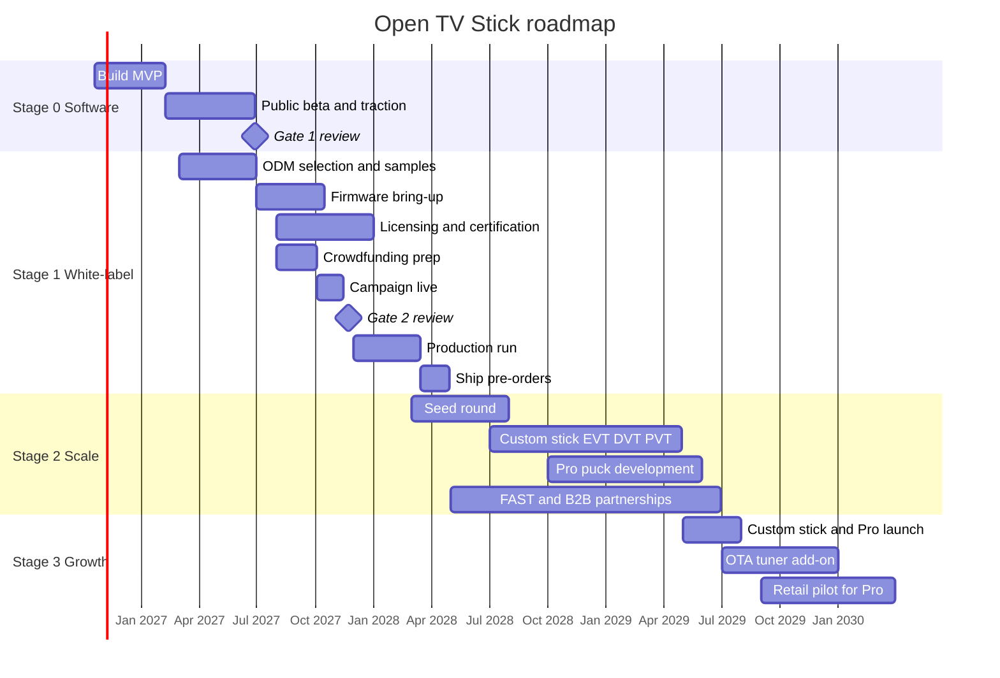

# Open TV Stick: Roadmap (Q4 2026 – 2030)

**Status:** Working draft, October 16, 2026
**Companion files (keep in the same folder):**

- `01_design_decisions.md`: what we decided and why ([open it](01_design_decisions.md))
- `03_stage0_weekly_plan.md`: week-by-week detail for Stage 0 ([open it](03_stage0_weekly_plan.md))
- `open_tv_stick_business_model.xlsx`: financial model ([open it](open_tv_stick_business_model.xlsx))

This is the big-picture timeline. Each stage ends at a **gate**: a go/no-go decision based on evidence. Don't start spending on the next stage until its gate is passed. Dates are targets, not promises; hardware schedules almost always slip, so buffers are built in.

---

## 1. The stages at a glance

| Stage | Dates (target) | Goal | Money needed | Funded by |
|---|---|---|---|---|
| **0a: Build** | Oct 2026 – Feb 2027 | Free open-source launcher app, public beta | ~$5–15K cash + founder time | Founder |
| **0b: Traction** | Feb – Jun 2027 | Prove demand: users, waitlist, contributors | ~$30–80K (first hire, devices, legal) | Founder, optional grant |
| **1: White-label hardware** | Jul 2027 – Apr 2028 | Ship our firmware + remote on an ODM's RK3539 stick | ~$200–400K | Pre-orders, small angel round |
| **2: Scale and custom hardware** | Apr 2028 – mid 2029 | Seed round, custom stick, Pro puck, partnerships | ~$500K–1M | Seed round, revenue |
| **3: Sustainable growth** | Mid 2029 – 2030+ | Full product family, profitability, retail for Pro | Self-funded target | Revenue |

---

## 2. Visual timeline

The chart below renders on GitHub, GitLab, Obsidian, and VS Code (with a Mermaid extension).

---

## 3. Quarter by quarter

### Q4 2026 (Oct – Dec): Stage 0a, building the MVP

- **Product:** Project setup; `provider-api` interface; home screen with remote-friendly navigation; Jellyfin provider with Media3 playback; catalog database; Internet Archive provider; unified search v1; handoff provider for 1–2 free streaming apps.
- **Business:** Choose name and check trademark; register domain; form the company (decide Texas LLC vs Delaware C-corp with an attorney); business bank account; first ODM outreach and sample orders; landing page with waitlist.
- **Milestone:** Working end-to-end demo on three test devices by mid-December.

### Q1 2027 (Jan – Mar): Stage 0a release, Stage 0b begins

- **Product:** Private alpha (~20 testers) in early January; hardening; **public beta v0.1 the week of February 1**; weekly releases afterward; second wave of handoff apps.
- **Business:** File trademark; contributor docs and CLA; Google Play and F-Droid listings; launch posts in Jellyfin, Android TV, cord-cutting, and privacy communities; devlogs every 2–3 weeks; consider an NLnet/NGI-style grant application for the software.
- **Team:** Start a paid trial project with a senior Android developer from India (March).
- **Hardware track:** Evaluate ODM samples; confirm SDK availability.
- **Milestone (Gate 0, early Feb):** Public beta live on GitHub, with F-Droid and Play submissions in review.

### Q2 2027 (Apr – Jun): Stage 0b, traction

- **Product:** HDHomeRun OTA provider; Plex provider (trial-hire project); polish based on user feedback; prototype our launcher as the default home screen on a generic RK3539 stick.
- **Business:** Apply to Crowd Supply early (they vet projects); shortlist one or two ODMs; write the BSP engineer job description; begin angel conversations informally; update the spreadsheet with real data.
- **Team:** Convert the Android trial hire to ongoing if it went well.
- **Milestone: Gate 1 (end of June).** See section 4.

### Q3 2027 (Jul – Sep): Stage 1, firmware and campaign prep

- **Product:** Hire the AOSP/BSP engineer; bring up AOSP on the ODM stick from the SDK; launcher as HOME; remote pairing and custom keys; CEC; A/B OTA pipeline; prototype the remote (nRF + keypad).
- **Business:** Sign ODM agreement (white-label, firmware freedom, SDK, certification reuse, license-inclusive pricing where possible); join HDMI as an adopter; Bluetooth SIG membership; contact codec pools; TMDB commercial license; crowdfunding page, video, and pricing; small angel round (~$150–300K) to cover pre-campaign costs.
- **Milestone:** Working prototype units with our firmware, suitable for the campaign video and reviewers.

### Q4 2027 (Oct – Dec): Stage 1, campaign and production order

- **Campaign:** Launch the first week of October; run about 6 weeks.
- **Gate 2 (late November):** See section 4.
- **Production:** Place the production order and deposit in December; certification (FCC/CE, or reuse of the ODM's grants where allowed); production firmware freeze; packaging and manuals.
- **Watch out:** Chinese New Year falls on January 26, 2028. Factories slow or close for 2–4 weeks around it, so build that into the schedule.

### Q1 2028 (Jan – Mar): Stage 1, production

- **Production:** Pilot run and quality checks; mass production; fulfillment partner set up; final OTA infrastructure and staged rollout tooling.
- **Business:** Seed round preparation begins (deck built on users, campaign results, waitlist).

### Q2 2028 (Apr – Jun): Stage 1 complete, Stage 2 begins

- **Ship pre-orders** (March–April); support channel live; first OTA updates.
- **Gate 3 (end of June):** See section 4.
- **Business:** Open the direct store for ongoing sales; seed round; first FAST partner conversations; library pilot conversations.
- **Team:** Hardware/ODM manager; second software engineer.

### H2 2028: Stage 2, building the product family

- Custom stick design begins: EVT → DVT → PVT (engineering, design, and production validation builds), roughly 9–12 months.
- Pro puck development starts in Q4.
- FAST distribution deals → native playback for partnered channels.
- B2B pilots (libraries first).
- Linux + Kodi community image work begins with contributors.

### 2029: Stage 2 → Stage 3

- **H1:** Custom stick v1 and Pro puck launch (May–July target).
- **H2:** OTA tuner add-on (sign with Avanci Broadcast early for the 75,000-unit fee waiver); retail pilot for the Pro puck.
- **Target (per base-case model):** first profitable year.

### 2030 and beyond: Stage 3

- Maintenance reserve fully funds the software team (base-case target).
- Expand B2B licensing; evaluate a DRM-capable premium model if customers ask for Netflix/Disney+ support.
- Stick v2 planning.

---

## 4. Gates: what must be true to proceed

Write the targets down now so they can't be rationalized later.

| Gate | When | Pass criteria | If it fails |
|---|---|---|---|
| **Gate 0: MVP ready** | Week 16 (early Feb 2027) | Jellyfin, Internet Archive, and at least one handoff provider working; unified search; smooth remote navigation on 3 devices; crash-free in alpha | Extend Stage 0a by up to 6 weeks; cut scope rather than quality |
| **Gate 1: Demand proven** | End of June 2027 | ≥ 5,000 active users of the free app; ≥ 2,000 hardware waitlist signups; ≥ 5 outside contributors; ≥ 1 ODM sample passing evaluation with SDK access confirmed | Stay software-only longer; refine positioning; reconsider target audience. Do not commit to hardware |
| **Gate 2: Campaign funded** | Late Nov 2027 | Pre-orders cover the first production run and certification, roughly ≥ 2,500 units (~$220K at $89) | Delay production; refund or extend; revisit price or product |
| **Gate 3: Shipped well** | End of June 2028 | Pre-orders delivered; return rate < 5%; positive reviews; OTA updates working; seed round in progress | Fix quality issues before scaling; delay custom hardware |

---

## 5. Supporting timelines

### Team

| When | Hire | Notes |
|---|---|---|
| Oct 2026 | Founder builds Stage 0 | Full time recommended; stretch the week plan if part time |
| Mar 2027 | Senior Android developer (India), paid trial | Trial project: Plex provider |
| Jul 2027 | AOSP/BSP engineer | Critical path for Stage 1 |
| Sep 2027 | Part-time QA tester | Device shelf, regression testing |
| Q2 2028 | Hardware/ODM manager | Custom hardware program |
| Q2 2028 | Second software engineer | Providers, launcher |
| 2029 | Grow to model's staffing levels | Per Assumptions tab |

### Funding

| When | Source | Amount (rough) | Purpose |
|---|---|---|---|
| Q4 2026 – Q2 2027 | Founder | $35–95K total | Devices, legal, company setup, first hire |
| Q1 2027 | Open-source grant (optional) | Varies | Software development |
| Q3 2027 | Angels (small round) | $150–300K | BSP engineer, licensing, prototypes, campaign |
| Q4 2027 | Crowdfunding pre-orders | $200–400K | First production run, certification |
| Q2 2028 | Seed round | $500K–1M | Custom hardware, team, inventory |
| 2028+ | Inventory / revenue-based financing | As needed | Production runs |

### Legal, licensing, and certification

| When | Item |
|---|---|
| Q4 2026 | Company formation; name clearance; domain |
| Q1 2027 | Trademark filing; open-source licenses and CLA finalized; privacy policy |
| Q3 2027 | ODM agreement; HDMI adopter; Bluetooth SIG; codec pools (AVC, HEVC, AAC); TMDB commercial license; decide on Sisvel |
| Q4 2027 | FCC/CE (or ODM grant reuse); HDMI compliance test for logo use; Bluetooth qualification listing |
| 2029 | Avanci Broadcast for tuner; certification for new designs |

---

## 6. Critical path

The sequence that determines when hardware ships. A slip in any step delays everything after it:

1. ODM confirms SDK access and firmware freedom
2. AOSP bring-up on the ODM stick
3. Prototype units ready for campaign video and reviewers
4. Campaign launch → Gate 2
5. Production deposit
6. Certification
7. Mass production (watch Chinese New Year)
8. Shipping

The software (Stage 0) runs ahead of this path on purpose, so the launcher is mature by the time hardware exists.

---

## 7. Alignment with the spreadsheet

The model's year columns start at 2027 as the **first year of sales**. On this roadmap, the first production batch ships in March–April 2028, so map the model like this:

| Model column | Roadmap year | What happens |
|---|---|---|
| 2027 (sales year 1) | 2028 | Crowdfunded batch ships; direct store opens |
| 2028 (sales year 2) | 2029 | Custom stick and Pro launch |
| 2029 (sales year 3) | 2030 | First profitable year in base case |
| 2030 (sales year 4) | 2031 | Reserve funds software team |
| 2031 (sales year 5) | 2032 | Scale |

If you prefer the labels to match the calendar, change the year headers on the Assumptions and Projection tabs (they're text cells) and the reference year on the Sensitivity tab. Stage 0 and Stage 1 pre-sales costs (roughly Q4 2026 – Q1 2028) are not in the model; they're covered by the founder, angels, and pre-orders as shown in section 5.

---

## 8. Review cadence

- **Weekly:** Stage 0 plan check-in (`03_stage0_weekly_plan.md`).
- **Monthly:** Update metrics (users, waitlist, contributors); adjust the next month's plan.
- **Quarterly:** Review this roadmap and the design decisions document; update the spreadsheet with actual numbers.
- **At each gate:** Formal go/no-go against the criteria in section 4, written down with the date.
